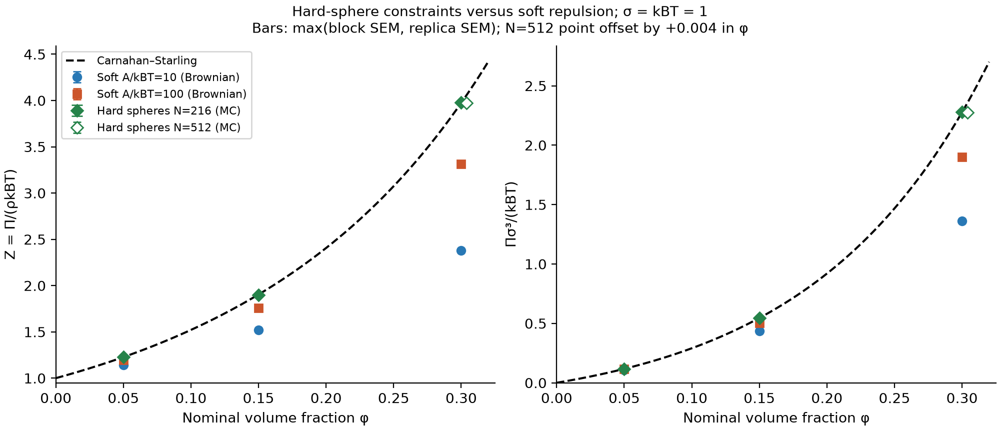

# Soft Repulsion and Hard-Sphere Equations of State

These two experiments explore whether plain Codex can select a numerical method, construct an environment, perform a calculation and explain its checks from a scientific task description. They belong to the [Agentic Workbench (wb) demonstrations](../README.md), but were conducted without Workbench-specific tools, according to the author and the retained reports.

The author supplied the scientific questions, expectations and resource constraints. ChatGPT formulated the detailed execution prompts, which were then given to Codex. The prompts are archived task descriptions, not instructions to execute when reading this repository.

## 1. Soft-repulsive Brownian dynamics

The first task compares concentration-dependent osmotic pressure for particles with finite cosine repulsion against the Carnahan–Starling hard-sphere equation of state. Codex selected LAMMPS and reported calculations at nominal volume fractions 0.05, 0.15 and 0.30, with amplitudes A/kBT = 10 and 100.

- [Execution prompt](PROMPT_Carnahan_Starling_vs_BD_soft_repulsive_particles.md)
- [Experiment guide and included files](soft-repulsive-bd/README.md)
- [Codex-generated report](soft-repulsive-bd/REPORT.md)
- [Package selection](soft-repulsive-bd/PACKAGE_SELECTION.md)
- [Equation-of-state figure: PDF](soft-repulsive-bd/figures/equation_of_state.pdf)

## 2. Constraint-only hard-sphere Monte Carlo

The follow-up removes the finite soft potential. Codex selected equilibrium NVT Metropolis Monte Carlo with overlap rejection, and replaced the force-based pressure estimator with contact and virtual-compression estimators. **This samples an equilibrium equation of state; it does not simulate physical Brownian time evolution.**

- [Follow-up execution prompt](PROMPT_Carnahan_Starling_vs_MC_hard_spheres.md)
- [Experiment guide and included files](hard-sphere-mc/README.md)
- [Codex-generated report](hard-sphere-mc/REPORT.md)
- [Comparison figure: PDF](hard-sphere-mc/figures/comparison.pdf)

The retained comparison figure shows the reported simulation estimates, their sampling error bars and the Carnahan–Starling reference. It has not been regenerated during publication preparation.

## What the reports say

At nominal volume fraction 0.30, the soft-particle report gives compressibility factors Z = 2.3776 ± 0.0043 and 3.3147 ± 0.0130 for A/kBT = 10 and 100. The hard-sphere report gives Z = 3.97791 ± 0.00760, compared with the Carnahan–Starling value 3.97376. These are reported one-standard-error estimates; finite-size, extrapolation and other systematic effects are not all included.

The reports record total elapsed times of 13 minutes 14.734641 seconds for the soft experiment, including a server restart, and 13 minutes 53.310748 seconds for the extension. Those are historical run records, not timings measured by this publication review or general performance benchmarks. The full raw timing logs are omitted.

These examples illustrate AI-assisted task formulation and implementation of exploratory prototypes. They do not establish new scientific findings, fully converged equations of state or a measured advantage from using wb.

## Scope of this archive

Both experiment directories include scripts, initialization inputs, reports and figures. Raw observations, output summaries, validation artifacts, dependency locks, original software/source downloads and execution logs are absent. References to `test_local/` and `hard_sphere_extension/` inside preserved material describe the original workspace. In this archive the experiments are siblings named `soft-repulsive-bd/` and `hard-sphere-mc/`; the original scripts have not been ported to this layout.

The archive notices identify this difference without rewriting the historical report or submitted prompt bodies. The experiment guides explain the missing prerequisites. Reading the prompt does not authorize its execution, package installation or filesystem changes.

For attribution, file hashes and preservation details, see [PROVENANCE.json](../PROVENANCE.json). Project-owned material follows the existing [CC BY 4.0 notice](../../LICENSE); third-party rights remain separate. For the broader motivation, see the author's [introduction](../../README.md).

**AI-generated text.** Original overview model: unrecorded. Publication revision: OpenAI Codex, 2026-11-13; exact revision model unverified. Human scientific direction and selection: Gunwoo Park. This page summarizes the retained artifacts and the author's account; it does not certify their calculations.
