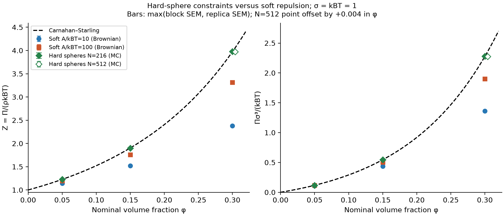

> **Archive notice — AI-generated historical report.** Codex produced this report; the exact original model is unrecorded. Its supplied body is preserved verbatim below. References to the parent environment, soft-result CSV, archived reference source, validation, logs and checksums describe the original `test_local/hard_sphere_extension/` workspace; those materials are omitted here. The public experiment folders are now siblings, while the retained scripts still expect the original nesting. Reported results, checks, timing and preservation claims were not independently reproduced during publication preparation. Read the current [experiment guide](README.md) and [provenance inventory](../../PROVENANCE.json).
>
> AI-generated publication notice: OpenAI Codex, 2026-11-13; exact revision model unverified.

<!-- archived-body-start -->
# Hard-sphere equation-of-state extension

True excluded-volume configurations were sampled without a soft potential. The measured hard-sphere EOS is close to Carnahan–Starling at all three requested volume fractions, while the preserved soft-particle results lie below it. Sampling and estimator sensitivities are reported separately from algorithm checks.

## 1. Algorithm and justification

Canonical (NVT) Metropolis Monte Carlo was selected because the objective is an equilibrium EOS. At each attempt, choose one particle uniformly, add a displacement uniform in a cube [−δ,δ]³, wrap into the periodic cubic box, and reject if any minimum-image center separation is less than σ=1. Accepted configurations therefore satisfy the hard-sphere constraints exactly to floating-point arithmetic. There are no forces, energy evaluations, spring constants or integration timesteps.

The equilibrium target is uniform over allowed labeled configurations. Symmetric proposals and accept/reject by feasibility obey detailed balance for this target. Particles are selected with replacement; one sweep is N attempts. Displacements may pass through other particles between endpoints: the algorithm samples equilibrium configurations and is **not physical Brownian motion**, reflected Brownian dynamics or a transport model. MC sweeps and displacement diagnostics cannot be converted to the previous Brownian time.

A small explicit all-pairs implementation was written and accelerated using Numba. Allen and Tildesley's public CC0 hard-sphere examples were inspected and their independent NumPy overlap routine was executed as a verification reference. Their original files are preserved unmodified in source/. Snapshot commit: 5c4266fcdebe6271f07529d9182bfaef54fcaaed; source: [Allen-Tildesley/examples](https://github.com/Allen-Tildesley/examples). This is an independently written small sampler, not a modified installation of their full program.

Event-driven molecular dynamics could supply pressure from collision impulses but adds event bookkeeping and represents inertial dynamics. Reflected/constraint Brownian methods require additional treatment of collision paths and simultaneous contacts. Neither is needed to obtain this equilibrium EOS; neither was executed.

## 2. Hard-sphere pressure estimator

The previous finite-force soft-potential virial was replaced. For hard spheres the equilibrium contact relation is

Z = 1 + (2πρσ³/3) g_N(σ⁺) = 1 + 4φ g_N(σ⁺).

Here g_N is normalized so the expected number of unordered pairs in a shell of volume Δv is (Nρ/2)g_N Δv. No N/(N−1) correction is applied. This finite-N convention is consistent with the canonical pressure and is checked against an exact two-particle result.

The contact identity follows from differentiating the allowed configurational volume under uniform compression. To first order in e=−ln(V′/V), overlaps arise from pairs in σ<r<σ exp(e/3). Their expected count is Nρ·2πσ³ g_N e/3; this gives the excess part of Z. It does not assign a finite force to hard-sphere contacts.

Pair counts were accumulated in exact spherical shells of width 0.002σ from r=1 to 1.12. The primary contact value extrapolates a quadratic local g(r) over 1<r<1.06 to r=1. The polynomial basis is integrated over each shell using its r² measure; geometry-only shell-volume weights are used. This fit estimates a boundary value from sampled pair counts. It never uses CS values, adjusts σ, or forces pressure agreement. Ranges/degrees were specified before inspecting the estimates; alternative ranges are reported below.

An independent estimator uses virtual compression. If p₀(e) is the probability that uniform scaling by exp(−e/3) remains overlap-free, then the configurational-integral ratio is Q(V exp(−e))/Q(V)=exp(−Ne)p₀(e). Consequently

Z = 1 − lim(e→0⁺) ln p₀(e)/(Ne).

For each sample, feasibility is determined from its minimum pair distance. Five e values [0.1,0.2,0.4,0.6,0.8]/N were measured and a straight-line extrapolation in e gives the zero-compression estimate. Block jackknife errors include the correlations between these nested compression events. Contact and compression estimators use the same configurations, so their differences were assessed with a paired jackknife, not by assuming statistical independence.

## 3. Parameters and completed calculations

Units and diameter match the previous study: σ=kBT=1, φ=πN/(6V), and Πσ³/kBT=ρZ. No effective diameter is introduced.

- Main calculations: N=216, φ=0.05,0.15,0.30, three independent seeds per φ.
- Size check: N=512 at φ=0.30, three additional seeds.
- Proposal check: N=216 at φ=0.30 with fixed δ=0.10, three additional seeds.
- Each trajectory: 3000 equilibration sweeps and 30,000 production sweeps, sampled every 5 sweeps.
- Main/size runs tune δ only during the first 1000 equilibration sweeps; the following 2000 sweeps and all production use fixed δ. Proposal-check runs do not tune.
- Initial simple-cubic lattices are non-overlapping. Exact seeds, box lengths, proposal sizes and manifests are in inputs/.
- Fifteen production trajectories completed, totaling 450,000 production sweeps, 90,000 recorded configurations and 136,224,000 attempted moves including equilibration. A separate pilot and reference/analytic tests also ran.

## 4. Numerical results

| φ | N | Hard-sphere Z ± SEM | Πσ³/kBT ± SEM | CS Z |
|---:|---:|---:|---:|---:|
| 0.05 | 216 | 1.22677 ± 0.00172 | 0.117148 ± 0.000164 | 1.22744 |
| 0.15 | 216 | 1.90014 ± 0.00354 | 0.544349 ± 0.001014 | 1.90372 |
| 0.30 | 216 | 3.97791 ± 0.00760 | 2.279172 ± 0.004353 | 3.97376 |

All uncertainties are estimated one-standard-error values, not 95% intervals. Each trajectory has thirty blocks of 1000 production sweeps, giving ninety blocks per condition. Reported SEM is the larger of the block-mean SEM and the SEM of the three replica means. Extrapolation bias and finite-size effects are not included in those sampling error bars.

Previous soft data are read unchanged from ../outputs/summary.csv. The comparison contains A/kBT=10 and 100 Brownian simulations, constraint-only hard-sphere MC and nominal-diameter CS. The open N=512 symbol is offset by +0.004 in φ only for visibility. A PDF is also provided. The soft study used two replicas with blocks of two Brownian time units; the new study uses three replicas with 1000-sweep MC blocks. Both report the larger block/replica SEM, but neither uncertainty estimate includes all systematic errors.

At φ=0.30, the preserved soft values are Z=2.3776±0.0043 and 3.3147±0.0130, whereas hard spheres give Z=3.9779±0.0076 and CS gives 3.9738. The hard results differ from CS by −0.055%, −0.188% and +0.104% across the three φ values. CS is a thermodynamic-limit approximation, not an exact finite-N identity or an input to either estimator. Agreement within this precision is an observed outcome.

## 5. Verification, sensitivity and limits

**Algorithmic correctness.** All 5000 prescribed trial moves agreed with the archived Allen–Tildesley overlap routine, including accepted/rejected decisions and coordinates. Explicit tests below, at and above contact across a periodic boundary passed. Every production sample had minimum center distance at least σ; the smallest recorded value was 1.000000002586691σ. Independent NumPy all-pairs checks of 465 saved configurations found no overlaps, and final NumPy histograms matched the simulation histograms exactly.

An N=2, L=3 test uses Q(V) proportional to V(V−v_ex), v_ex=4π/3. Its exact Z is 1+v_ex/[2(V−v_ex)]=1.0918143. The simulation measured 1.0892103±0.0043316. Measured virtual-compression survival probabilities also matched the exact conditional excluded-volume expression; direct affine-compression overlap tests agreed with the minimum-distance criterion. These tests do not use Carnahan–Starling.

**Statistical checks.** Production-half differences were at most 1.743 combined block SEM. Block lengths 250,500,1000,2000 sweeps and heuristic autocorrelation estimates are archived in validation/sampling.csv. Sampled instantaneous contact-estimator autocorrelation times were approximately 2.5–4.1 sweeps, with lags below the five-sweep recording interval unresolved. All chains moved substantially during production; proposal-dependent MSD is only a mixing diagnostic. These checks support exploratory sampling but do not prove complete equilibration or asymptotic error-bar convergence.

**Pressure-estimator cross-check.**

| φ | Contact Z ± SEM | Virtual-compression Z ± SEM | Difference / paired SEM |
|---:|---:|---:|---:|
| 0.05 | 1.2268 ± 0.0017 | 1.2163 ± 0.0110 | 0.96 |
| 0.15 | 1.9001 ± 0.0035 | 1.8647 ± 0.0213 | 1.72 |
| 0.30 | 3.9779 ± 0.0076 | 3.9128 ± 0.0478 | 1.35 |

Differences between contact and virtual-compression estimates were below 1.72 paired jackknife SEM. The virtual-compression route is considerably noisier and has its own zero-compression extrapolation error; this is a useful independent formulation, not an equally precise reference.

**Contact extrapolation.** Quadratic ranges 0.04–0.10σ changed the main Z estimates by at most 0.00041,0.00131,0.00459 at φ=0.05,0.15,0.30, respectively. At φ=0.30 a linear fit over 0.06σ gives 3.96510, 0.01280 below the primary quadratic estimate (2.38 paired SEM); a narrower linear range of 0.03σ gives 3.97286. This exposes curvature sensitivity. The quadratic estimates across the tested ranges were stable within the present sampling precision, but contact-limit bias is not proven negligible and is not absorbed into statistical error bars. See validation/contact_ranges.csv and figures/estimator_checks.png.

**Size/proposal checks at φ=0.30.**

| Check | Comparison Z | Change from N=216 main Z | Combined SEM |
|---|---:|---:|---:|
| size (N=512) | 3.97353 | -0.00437 | 0.00896 |
| proposal (N=216) | 3.97639 | -0.00152 | 0.01103 |

Neither comparison resolves a shift at this precision. Two sizes at one concentration and one alternative proposal size do not establish thermodynamic-limit or universal sampling convergence. More sizes, replicas and longer runs would be required for a rigorous error budget. No Brownian dynamics or transport conclusions follow from these MC calculations.

**Physical agreement.** The exact two-particle EOS and independent constraint/estimator checks support the model implementation. The dense-fluid CS comparison supports the equilibrium EOS at the tested precision; it does not validate physical Brownian trajectories. No soft-stiffness limit was used to generate the hard-sphere data.

## 6. Reuse and reproducibility

Reused: the parent Python 3.14.10 executable, Matplotlib 3.11.2, the previous soft-result CSV, the σ/kBT convention, and the resource/statistical/plotting approach. The previous wrapper was copied and adapted entirely inside the extension. NumPy remains version 2.5.4; the dependency installer placed another copy in the extension target directory. New dependencies are Numba 0.68.1 and llvmlite 0.50.0. LAMMPS and MPICH remain installed but are not used for the hard-sphere sampler.

Replaced: force-based Brownian integration, the soft potential and its pressure estimator. New code implements feasibility-only Metropolis sampling, contact histograms, virtual-compression probabilities and associated checks. Reference files are unmodified. No Workbench-specific capability, plugin, template, profile or protocol was used.

[README.md](README.md) lists the directory structure and exact commands. From this directory, sh scripts/bootstrap.sh reconstructs the added local dependencies and sh scripts/reproduce.sh runs verification, all 15 production trajectories and analysis. Repetition overwrites named outputs, so retain an original copy. Parent environment locks, added version locks, raw data, starting/saved/final configurations, scripts, source references and checksums are preserved.

A complete before/after hash comparison protects every pre-existing file under test_local/ outside this extension. Its completion audit is in validation/preservation.json. No previous soft-particle file was changed.

## 7. Resources, failures and workflow

- One CPU, one simulation worker, no parallel Numba kernels or MPI ranks.
- Largest recorded process RSS: 296,528 KiB (303.6 MB).
- Production simulation peak RSS: 153,024 KiB (156.7 MB).
- Total test_local/ workspace footprint at report generation: 835,977,216 bytes (0.836 GB).
- Extension footprint: 277,823,488 bytes (0.278 GB).

CPU affinity and thread environment settings constrain installation, JIT, simulation and analysis to one allowed CPU. A 4,000,000,000-byte per-process address-space cap and 1 GB file-size cap are enforced. There is no aggregate cgroup memory cap or directory disk quota; per-process peak RSS and phase-boundary workspace disk use were measured instead. No host configuration or security policy changed.

A source-discovery command initially ran before the copied wrapper existed; retry succeeded. A generic repository LICENSE URL returned 404; the reference files themselves contain a CC0 license notice. The pilot's relative venv path caused harmless prefix warnings; subsequent commands used an absolute path and the wrapper now normalizes executable paths. A documentation tool submission had a JavaScript syntax error before execution and was resubmitted. An environment-metadata command initially used a relative parent path incorrectly, failed before changing previous files, and succeeded after using the absolute working directory. None of these retries changed completed simulation results. Analysis was extended to account explicitly for estimator covariance and to count each named data artifact once if a researcher appends rerun records. No human intervention or external approval was needed; no server interruption occurred in this extension.

## 8. Time accounting and assessment

Start: **2026-11-13T21:40:00.510305+00:00**, before substantive inspection. Actual completion time and total elapsed wall time are appended after final verification.

| Phase | Measured wall seconds |
|---|---:|
| environment | 8.054 |
| discovery_retry | 1.814 |
| pilot | 3.607 |
| algorithm_verification | 3.407 |
| main_simulations | 25.229 |
| size_simulations | 35.641 |
| proposal_simulations | 11.025 |
| analysis | 2.405 |
| paired_estimator_analysis | 2.613 |

Phase durations are measured subprocess intervals; some setup/provenance work overlaps. Total elapsed time includes reasoning, implementation, installation, execution, verification and documentation and must not be obtained by summing overlapping phases.

The previous prototype could be extended while preserving its data, environment and units. The equilibrium representation and pressure estimator required substantive replacement. A working constraint-only EOS prototype, independent checks and comparison figures were achieved autonomously. A more rigorous study would refine the contact/compression limits, increase replica count and sample length, compare more system sizes and investigate structural relaxation. Physical Brownian evolution would require a separately validated dynamics algorithm.

## Completion record

Completion: **2026-11-13T21:53:53.821053+00:00**. Total elapsed wall-clock time: **0 hours, 13 minutes, 53.310748 seconds** (833.310748 seconds). This timestamp follows scientific calculations, report preparation, preservation and artifact checks; timestamp/checksum files were then written. All 7314 pre-existing files were unchanged. No human intervention or Workbench-specific capability was used. Total workspace disk footprint before final metadata: 835,993,600 bytes.
