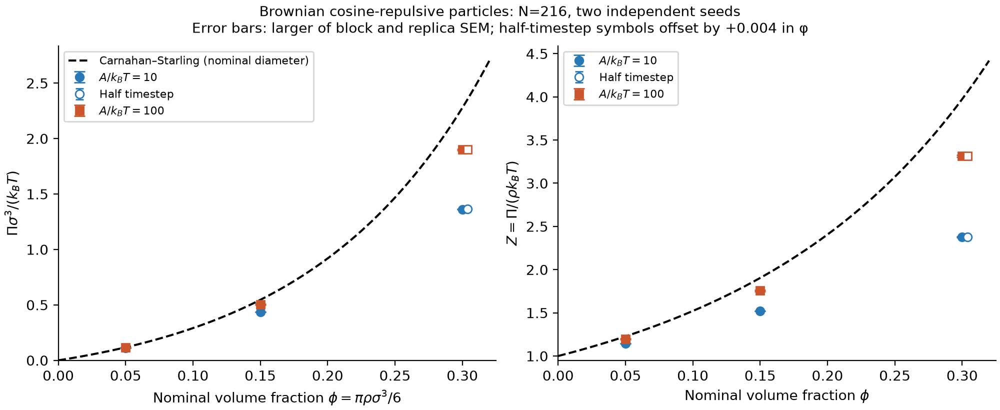

> **Archive notice — AI-generated historical report.** Codex produced this report; the exact original model is unrecorded. Its supplied body is preserved verbatim below. Statements that files are retained and commands are reproducible refer to the original full `test_local/` workspace. This selected archive omits raw outputs, validation records, environment locks, downloads, source archives and logs, including the linked `outputs/summary.csv`. Reported results, checks, timing and resource use were not independently reproduced during publication preparation. Read the current [experiment guide](README.md) and [provenance inventory](../../PROVENANCE.json) for the available materials.
>
> AI-generated publication notice: OpenAI Codex, 2026-11-13; exact revision model unverified.

<!-- archived-body-start -->
# Autonomous Brownian osmotic-pressure prototype

The completed simulations show increasing osmotic pressure with concentration and repulsive stiffness. Both soft systems lie below Carnahan–Starling evaluated at the fixed nominal diameter; the stiffer system is closer to that reference. These are exploratory finite-system results.

## Scientific implementation

**Package and source.** LAMMPS 22 Jul 2025, Update 4 (PyPI lammps==2025.7.22.4.0), GPL v2, was obtained from PyPI as a compatible Linux AArch64 wheel. Upstream tag stable_22Jul2025_update4 resolves to commit 611ca3b7f8525ba802373b04f9e3d632d515f7e3. The original wheel, release metadata, license, and unmodified source excerpts/documentation are preserved. Source inspection covered the Brownian integrator, soft pair potential and pressure calculation. HOOMD-blue and OpenMM were evaluated as alternatives from public source. [PACKAGE_SELECTION.md](PACKAGE_SELECTION.md) records the comparison, sources and reasons for selection. A compiler/source build was unnecessary; binary loading and actual execution were checked. No package source was modified.

**Model.** Particles in three-dimensional periodic cubic boxes interact through

U(r) = A[1 + cos(πr/σ)] for r < σ, and zero otherwise.

The outward force magnitude is Aπ/σ sin(πr/σ). Energy and force are continuous at the cutoff. Set σ=kBT=γ=1, giving isolated diffusion coefficient D₀=kBT/γ=1 and Brownian time σ²/D₀=1. Amplitudes A/kBT=10 and 100 correspond to contact barriers 20 and 200 kBT and local overlap stiffness U″(σ⁻)=Aπ²/σ². These are penetrable soft particles: φ=πNσ³/(6V) is a nominal volume fraction based on the fixed cutoff diameter, not a measured excluded volume. There are no hydrodynamic interactions, explicit solvent degrees of freedom, inertia or attractions.

**Numerical method.** LAMMPS fix brownian with gamma_t=1 and Gaussian noise advances overdamped positions:

Δr = (F/γ)Δt + √(2kBTΔt/γ) ξ,

with independent standard Gaussian vectors. Each main condition used N=216 particles, initialized on a 6×6×6 simple cubic lattice, with two distinct random seeds. All initial nearest-neighbor separations exceed σ. Equilibration lasted 5 Brownian time units; the following 20 units were sampled every 0.01. Timesteps were 10⁻⁴ for A=10 and 2×10⁻⁵ for A=100. Box lengths for φ=0.05, 0.15, 0.30 were 13.126858, 9.101655, 7.223988. Exact inputs, seeds and parameters are archived in the input manifests.

**Pressure estimator.** The particle osmotic pressure relative to the implicit solvent reservoir is

Π = ρkBT + ⟨Σ(i<j) rᵢⱼ·Fᵢⱼ⟩/(3V).

LAMMPS compute pressure with NULL temperature and pair-only contributions supplies the configurational term; the ideal reservoir term ρkBT is added explicitly. The implementation stores Brownian displacement divided by timestep as velocity, so those velocities are not used to estimate kinetic temperature or pressure. Interactions have finite range; no tail correction is needed. Pair separations use the periodic minimum image.

The unmodified Carnahan–Starling comparison is Z_CS=(1+φ+φ²−φ³)/(1−φ)³, with Π_CS=ρkBT Z_CS and the same nominal φ. No particle diameter or measured data was fitted to obtain agreement. Reference: Carnahan & Starling, J. Chem. Phys. 51, 635–636 (1969), DOI [10.1063/1.1672048](https://doi.org/10.1063/1.1672048).

## Completed results

Twelve main trajectories (two amplitudes × three concentrations × two seeds) and four independent half-timestep trajectories at φ=0.30 completed: 15,000,000 integration steps in total, excluding the 10,000-step pilot and software checks. There are 2,000 production samples per trajectory. Raw time series, equilibrated/final configurations, restart files and individual execution logs are retained.

| φ | A/kBT | Πσ³/kBT ± SEM | Z ± SEM | CS Z | Difference from CS |
|---:|---:|---:|---:|---:|---:|
| 0.05 | 10 | 0.109300 ± 0.000155 | 1.1446 ± 0.0016 | 1.2274 | -6.75% |
| 0.05 | 100 | 0.114381 ± 0.000365 | 1.1978 ± 0.0038 | 1.2274 | -2.42% |
| 0.15 | 10 | 0.435856 ± 0.000576 | 1.5214 ± 0.0020 | 1.9037 | -20.08% |
| 0.15 | 100 | 0.503118 ± 0.002978 | 1.7562 ± 0.0104 | 1.9037 | -7.75% |
| 0.30 | 10 | 1.362249 ± 0.002490 | 2.3776 ± 0.0043 | 3.9738 | -40.17% |
| 0.30 | 100 | 1.899172 ± 0.007472 | 3.3147 ± 0.0130 | 3.9738 | -16.59% |

Uncertainties are **one estimated standard error**, not 95% confidence intervals. Each production record is divided into ten blocks of length 2 Brownian time units, giving twenty blocks across two replicas. The reported SEM is the larger of the SEM of these block means and the SEM of the two replica means. This accounts for observed replica variability, but two replicas give a weak estimate of between-run uncertainty. Finite-size and integration biases are not included.

Filled symbols show main results; open symbols show half-timestep checks, offset by +0.004 in φ only for visibility. The CS curve uses nominal φ. [outputs/summary.csv](outputs/summary.csv) contains numerical values; the figure is also available as PDF. Simulation markers are not connected to avoid suggesting an unmeasured interpolation.

At φ=0.30, pressures are 40.17% below nominal CS for A=10 and 16.59% below for A=100. This is consistent with softer repulsion permitting closer approach. Independent potential-only quadrature gives B₂/σ³=1.41456 and 1.85594, compared with hard-sphere 2π/3=2.09440; ratios are 0.67540 and 0.88614. Barker–Henderson diameters from the same potential are 0.87217σ and 0.96006σ. These are explanatory diagnostics and were not used to transform φ or adjust the main CS comparison. Two stiffnesses do not establish an asymptotic hard-sphere EOS.

## Verification and limitations

**Software and estimator verification.** The installed binary loaded the Brownian and soft-potential styles. Two-particle energy, force and virial matched analytic expressions, including a pair spanning the periodic boundary. A central energy derivative matched the force. A 4,096-particle ideal-gas Brownian run over time 1 measured D=0.998167 versus 1, with expected finite-sample standard error 0.012758; its pair virial was zero. Independent O(N²) minimum-image pair sums for all sixteen final interacting configurations reproduced LAMMPS pressure with maximum absolute difference 6.66e-16. Raw output also satisfied Π=ρ+p_vir within its six-significant-digit text precision. See validation/software.json and validation/direct_virial.csv.

**Sampling and equilibration.** All samples were finite and pair pressures were nonnegative. End-of-equilibration MSD ranged from 15.494 to 32.557 σ², corresponding to RMS displacement exceeding 3.9σ in every run. Production half means differed by at most 2.216 combined block standard errors. Block-length checks (1, 2, 5 time units), block correlations and heuristic pressure autocorrelation estimates are archived in validation/sampling.csv. [Sampling traces](figures/sampling_diagnostics.png) include the discarded equilibration phase. These checks support the preliminary equilibration choice but do not establish stationarity or error-bar convergence. Autocorrelations faster than the sampling spacing of 0.01 are unresolved.

**Timestep sensitivity at φ=0.30.**

| A/kBT | Base Δt | Half Δt | Half-step Z | Change in Z | Change / combined SEM |
|---:|---:|---:|---:|---:|---:|
| 10 | 0.0001 | 5e-05 | 2.37896 | +0.001387 | +0.285 |
| 100 | 2e-05 | 1e-05 | 3.31445 | -0.000227 | -0.015 |

No timestep difference was statistically resolved at this precision. This comparison checks two step sizes at one concentration and does not establish zero-step convergence throughout the study. At A=100, φ=0.15, replica mean pressures were 0.50014 and 0.50610, illustrating the need for more replicas and longer runs. Only N=216 was used for interacting EOS data; finite-size dependence was not tested. Initial-lattice memory, limited production duration and only two seeds remain sources of uncertainty.

**Physical validation.** Ideal diffusion, the repulsive virial sign, stiffness trends and potential-derived excluded-volume integrals are consistent with the intended model. Carnahan–Starling is a hard-sphere reference rather than an exact validation target for this potential. Independent equilibrium Monte Carlo, a truly dilute virial-coefficient simulation test, structural relaxation diagnostics, system-size sweeps and additional stiffnesses were not performed. Full physical validation and quantitative hard-sphere agreement are not claimed.

## Reproducibility

All materials are inside test_local/. [README.md](README.md) gives the directory structure and exact commands. Python 3.14.10, LAMMPS 2025.7.22.4.0, MPICH 5.0.2, NumPy 2.5.4 and Matplotlib 3.11.2 were used; all transitive Python dependencies are pinned in env/requirements.lock. The original wheel is archived under downloads/, with SHA-256 a714cbb1bb1e487b16aec023255d867a3a560ae44a47dc7cd21d72a29a0ab755 verified against PyPI metadata. source/ is an unmodified excerpt of relevant upstream files, not a complete source checkout. No upstream code patches were made. New experiment code generates inputs, invokes LAMMPS, checks resources and analyzes results.

From test_local/, reconstruct the environment with sh scripts/bootstrap.sh and rerun calculations with sh scripts/reproduce.sh. To analyze archived data only, run python3 scripts/limited.py analysis env/venv/bin/python scripts/analyze.py. Repeated simulations overwrite named outputs; preserve an original copy first. Linux affinity/resource APIs are required. Other architectures, source builds and OS library changes have not been tested. SHA256SUMS verifies archived scripts, sources, inputs, results and figures; mutable logs/environment caches are excluded.

## Computational resources

All install/compute commands ran with CPU affinity restricted to **one allowed CPU**, inherited by descendants. One LAMMPS rank ran at a time without mpiexec. OpenMP, OpenBLAS, MKL, BLIS, NumExpr and Accelerate thread settings were 1. Simulation processes sometimes had two observed threads, including the MPI helper, sharing the same single-CPU affinity. This restricts simulation CPU use to one core despite twelve CPUs being visible initially.

The wrapper enforced **4,000,000,000 bytes of address space per process** with RLIMIT_AS and a 1 GB per-file size limit. These are not an aggregate cgroup memory cap or a directory disk quota. No host/cgroup configuration was changed. Resource measurements and limitations:

- Largest recorded process RSS: 126,016 KiB (129.0 MB).
- Main/timestep simulation peak RSS: 62,864 KiB (64.4 MB).
- Largest recorded disk snapshot: 558,067,712 bytes.
- Allocated directory footprint at report generation: 558,084,096 bytes (0.558 GB).

RSS measurements are per-process maxima, not aggregate simultaneous RSS or a guarantee about unsampled transients. The single-process simulations had substantial margin below 10 GB. Disk was checked at phase boundaries; no hard directory quota or continuous transient-usage measurement was available. Final disk usage is recorded in the execution log. The wrapper and measurements are in scripts/limited.py and logs/resources.jsonl.

## Time accounting

Experiment start: **2026-11-13T19:30:22.149334+00:00**, recorded before package inspection/installation. The completion timestamp and exact elapsed duration are appended after final artifact verification. Total wall time includes planning, environment construction, computation, analysis, documentation and the server restart.

| Timed phase | Measured wall time (s) |
|---|---:|
| Installation | 6.622 |
| Initial package/source discovery | 2.004 |
| Additional source and wheel archival | 3.012 |
| Additional provenance | 1.622 |
| Library/style load check | 0.401 |
| Pair/diffusion verification | 1.204 |
| Pilot | 0.402 |
| Main simulations | 135.810 |
| Half-timestep simulations | 95.551 |
| Analysis and figure runs | 4.621 |

These measured subprocess intervals do not account separately for all agent reasoning/documentation time. Some acquisition and setup intervals overlap and should not be summed as the total experiment duration. The earlier stopped/deleted experiment is separate. During this fresh experiment the server restarted; continuation was logged at 2026-11-13T19:33:07.191598+00:00. Verification and the pilot had completed, and no simulation remained running. The exact interruption onset and duration are unavailable and are not invented. No human input, policy approval or host intervention was required. Optional documentation hosts required network approval; accessible public GitHub source was used without changing network policy.

## Overall assessment

Package discovery, local environment construction, implementation inspection, estimator design, sixteen interacting trajectories, uncertainty estimates, timestep checks, figures and reproducible materials were completed autonomously within the resource constraints. The prototype supports the requested preliminary concentration/stiffness comparison. It does not establish rigorous convergence, finite-size independence or the hard-sphere limit.

A stronger study would increase replicas and sampling, measure structural relaxation, perform timestep/system-size extrapolations, add larger amplitudes with appropriate steps, and compare equilibrium pressure with an independent method. Those extensions are proposed rather than completed.

## Completion record

Experiment completion: **2026-11-13T19:43:36.883975+00:00**. Total elapsed wall-clock time: **0 hours, 13 minutes, 14.734641 seconds** (794.734641 s). This timestamp was taken after report preparation and artifact verification; final timestamp/checksum files were then written. No human intervention was required. Final pre-metadata directory footprint: 558,112,768 bytes.
